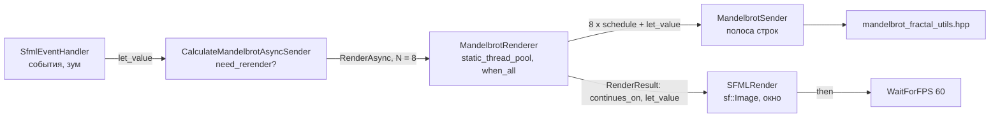

# Mandelbrot-Fractal

Приложение на C++23, которое рисует множество Мандельброта в окне SFML и позволяет
приближать и отдалять изображение мышью. Кадр строится конвейером сендеров
`stdexec` (P2300): ввод, параллельный расчёт полос изображения в пуле потоков,
вывод в окно, ограничение частоты кадров. Репозиторий создан из шаблона
практического задания 9-го спринта курса «Мидл разработчик С++» (`README.md:14`,
`LICENSE:3`); кто, кроме автора и ревьюера курса, пользуется проектом, в файлах
не указано.

## Состояние

- Последний коммит кода в этой ветке: `7621fdd`, 2025-09-19, «refactoring 3»
  (`git log`). Описание сделано по ветке `origin/dev`.
- В `origin/main` есть 18 более поздних коммитов (2026-04-01 – 2026-08-10), которых
  нет в этой ветке: английский README, сборка под Windows (MSVC), CI-workflow,
  исправление «Fix bug with deadlock» в `include/mandelbrot.hpp`, общая обвязка
  качества (`git log origin/dev..origin/main`). Здесь они не описаны.
- Тесты есть: 7 тестов GoogleTest в `tests/mandelbrot_test.cpp`.
- CI в этой ветке нет: каталогов `.github/` и `.gitea/` в `git ls-files` нет.
- `README.md` в корне остался текстом шаблона курса и описывает не это приложение
  (см. «Известные ограничения»).

## Структура

| Путь | Назначение |
|---|---|
| `src/main.cpp` | `MandelbrotApp`: окно, конвейер кадра, цикл до выхода; `FrameClock`, `WaitForFPS`; `main()` |
| `include/types.hpp` | `RenderSettings`, `PixelRegion`, `RenderResult`, `AppState`, `THREAD_POOL_SIZE = 8` |
| `include/mandelbrot_fractal_utils.hpp` | Математика: итерации точки, пиксель → комплексное число, итерации → цвет (из шаблона, после `8543c12` не менялся) |
| `include/mandelbrot_sender.hpp` | `MandelbrotSender`: матрица итераций для одной полосы пикселей |
| `include/mandelbrot_renderer.hpp` | `MandelbrotRenderer::RenderAsync<N>`: N полос в `exec::static_thread_pool`, сборка кадра |
| `include/mandelbrot.hpp` | `CalculateMandelbrotAsyncSender`: запуск рендера только при `need_rerender` |
| `include/sfml_events_handler.hpp` | `SfmlEventHandler`: события окна, непрерывный зум мышью |
| `include/sfml_renderer.hpp` | `SFMLRender`: копирование цветов в `sf::Image`, вывод в окно |
| `tests/mandelbrot_test.cpp`, `tests/main.cpp` | Тесты GoogleTest и их `main` |
| `CMakeLists.txt`, `conanfile.py` | Сборка: CMake + Conan, `stdexec` через CPM.cmake |
| `.devcontainer/` | Docker-образ Ubuntu с GCC 15, SFML из apt, Conan |
| `.vscode/` | Задачи сборки Debug/Release, конфигурации lldb, формат при сохранении |
| `.clang-format` | Стиль кода (LLVM, 120 колонок, отступ 4) |

## Архитектура

Один кадр — это один проход конвейера из `src/main.cpp:69-75`; конвейер
повторяется `exec::repeat_effect_until` до `AppState::should_exit`
(`src/main.cpp:77-80`) и запускается `stdexec::sync_wait` в главном потоке.



- Состояние приложения (`AppState`: видимая область, флаги кнопок мыши,
  `need_rerender`, `should_exit`) общее для `SfmlEventHandler` и
  `CalculateMandelbrotAsyncSender` и передаётся им по ссылке (`include/types.hpp:36-42`,
  `src/main.cpp:69-70`).
- Расчёт идёт в пуле из `THREAD_POOL_SIZE = 8` потоков (`src/main.cpp:59`), кадр
  делится на 8 горизонтальных полос (`include/mandelbrot.hpp:23`,
  `include/mandelbrot_renderer.hpp:19-27`).
- Результат возвращается на планировщик получателя через `stdexec::continues_on`
  (`include/mandelbrot.hpp:21-27`); вывод в окно выполняет `SFMLRender`.
- Внешних сервисов и оборудования нет. Файлы приложение не читает и не пишет.

## Сборка и запуск

Окружение — dev-контейнер VS Code (`README.md:22-29`, `.devcontainer/`):

- Ubuntu по фиксированному digest (`.devcontainer/Dockerfile:1`; имя контейнера
  «Ubuntu25.04 with GCC15», `.devcontainer/devcontainer.json:2`);
- `g++-15` как `g++`, `clang-format`, `clangd-20`, `cmake`, `make`
  (`.devcontainer/Dockerfile:8,21-22`), `libsfml-dev` из apt (`Dockerfile:11`),
  Conan через pipx (`Dockerfile:59`);
- CMake не ниже 3.30 (`CMakeLists.txt:1`; Conan подтягивает `cmake/3.30.0`,
  `conanfile.py:13`), GoogleTest `gtest/1.13.0` (`conanfile.py:12`);
- при конфигурации CMake скачивает из GitHub CPM.cmake и NVIDIA/stdexec
  (`CMakeLists.txt:20-35`), то есть нужна сеть.

Перед открытием контейнера на хосте задаются `USER_UID` и `USER_GID`
(`README.md:18-20`).

Сборка (задачи VS Code, `.vscode/tasks.json:8-10` и `:24-26`):

```bash
mkdir build ; cd build && conan build -b missing -s build_type=Debug ..
mkdir build ; cd build && conan build -b missing -s build_type=Release ..
```

F5 запускает конфигурацию lldb «Launch Debug MandelbrotFractal» с предварительной
сборкой Debug (`.vscode/launch.json:10-16`, `README.md:55-58`).

Запуск приложения (`README.md:64-67`):

```bash
cd build
./MandelbrotFractal
```

## Конфигурация

Конфигурационных файлов, переменных окружения и флагов командной строки у
приложения нет: `main()` без аргументов (`src/main.cpp:84`). Параметры заданы в коде.

| Параметр | Значение | Источник |
|---|---|---|
| Размер окна и кадра | 800 × 600 | `src/main.cpp:47`, `include/types.hpp:16-17` |
| Максимум итераций | 100 | `src/main.cpp:47` |
| Радиус выхода | 2.0 | `src/main.cpp:47` |
| Начальная область | Re [-2.5; 1.5], Im [-2.0; 2.0] | `include/mandelbrot_fractal_utils.hpp:10-18` |
| Потоков и полос | 8 | `include/types.hpp:10`, `src/main.cpp:59` |
| Шаг зума | 0.9 (приближение), 1/0.9 (отдаление) | `include/sfml_events_handler.hpp:78,84` |
| Интервал между шагами зума | 100 мс | `include/sfml_events_handler.hpp:19` |
| Целевая частота кадров | 60 | `src/main.cpp:75` |

Сборочные переменные: `USER_UID`, `USER_GID` — UID/GID пользователя `dev` в
контейнере (`.devcontainer/devcontainer.json:6-9`); в контейнер монтируются
`~/.gitconfig` и `~/.conan2` хоста (`devcontainer.json:25-28`).

## Использование

- Удерживать левую кнопку мыши над окном — изображение приближается к точке под
  курсором (область × 0.9) не чаще раза в 100 мс (`include/sfml_events_handler.hpp:63-93`).
- Удерживать правую кнопку — отдаляется в 1/0.9 раза с тем же шагом.
- Закрыть окно — приложение завершается с кодом 0 (`sfml_events_handler.hpp:46-47`,
  `src/main.cpp:92`).
- Клавиатура не обрабатывается (`sfml_events_handler.hpp:45-58`).
- При исключении печатается `Error: <текст>` и возвращается код 1 (`src/main.cpp:88-90`).

## Тестирование

Запуск (`README.md:71-74`):

```bash
cd build
./MandelbrotFractal_tests
```

Тест также зарегистрирован в CTest как `MandelbrotFractal_tests`
(`CMakeLists.txt:79-80`). Аргументы командной строки передаются в GoogleTest
(`tests/main.cpp:3-4`).

| Тест | Что проверяет |
|---|---|
| `MandelbrotSenderTest.CalculatesCorrectIterationsForKnownPoints` | размер матрицы 2×2; точка `-1-1i` уходит, точка `0` достигает максимума |
| `MandelbrotRendererTest.RenderAsyncProducesCorrectSizeOutput` | кадр 16×16 из 4 полос; центр (`-0.5`) чёрный; viewport и settings в результате |
| `SfmlEventHandlerTest.SetsShouldExitOnWindowClose` | при заранее выставленном `should_exit` сендер завершается `set_stopped` |
| `SfmlEventHandlerTest.SetsRerenderOnZoom` | при нажатой левой кнопке и курсоре в окне ширина области < 4.0, `need_rerender` (он `true` уже по умолчанию, `include/types.hpp:38`) |
| `SFMLRenderTest.RendersDataWhenProvided` | пиксели 2×1 копируются в `sf::Image` |
| `SFMLRenderTest.SkipsUpdateForEmptyData` | пустой результат не меняет `sf::Image` |
| `PipelineIntegrationTest.FullRenderPipelineSkipsRenderWhenNotNeeded` | без `need_rerender` возвращается пустой `RenderResult` |

Не покрыты тестами: преобразование итераций в цвет кроме чёрного, обработка событий
окна, ветка рендера в `CalculateMandelbrotAsyncSender`, цикл и ограничение FPS в
`src/main.cpp`. `TestReceiver` (`tests/mandelbrot_test.cpp:17-36`) объявлен, но не
используется.

## Известные ограничения и проблемы

- **Время жизни операции (вывод из кода).** В `CalculateMandelbrotAsyncSender`
  состояние операции `op` — локальная переменная внутри `start`
  (`include/mandelbrot.hpp:29-30`); `start` возвращается, пока полосы ещё
  считаются в пуле, и `op` уничтожается до завершения. Коммит `3156770` в
  `origin/main` («Fix bug with deadlock») заменил этот участок на `sync_wait`.
  Здесь не воспроизводилось.
- **Тесты `SFMLRenderTest`** не задают размер `sf::Texture` (`tests/mandelbrot_test.cpp:115,133`),
  а `SFMLRender` всегда вызывает `texture_.update(image_)` (`include/sfml_renderer.hpp:38`).
  В `origin/main` в тесты добавлен `texture.create(...)` с комментарием о выходе за
  границы и `assert` в Debug.
- Тесты с `sf::RenderWindow` требуют графического дисплея, а
  `SetsRerenderOnZoom` двигает настоящий курсор (`tests/mandelbrot_test.cpp:75,90,96,117,135`)
  — вывод из кода, на машине без дисплея не проверялось.
- Зависимости не закреплены: CPM.cmake — `origin/master`, stdexec — `main`
  (`CMakeLists.txt:24,31`). Результат сборки зависит от текущего состояния этих
  репозиториев; версия SFML определяется пакетом apt (`Dockerfile:11`).
- При высоте кадра меньше 8 строк `rows_per_task = 0`, и для пустой полосы
  выполняется `color_matrix[0]` у пустого вектора (`include/mandelbrot_renderer.hpp:19,35-39`)
  — вывод из кода; при фиксированных 800 × 600 не достигается.
- Размер кадра фиксирован (800 × 600, `src/main.cpp:47`), событие изменения размера
  окна не обрабатывается (`include/sfml_events_handler.hpp:45-58`).
- `RenderResult::render_time` вычисляется, но нигде не читается и измеряет только
  сборку кадра после `when_all`, а не расчёт (`include/mandelbrot_renderer.hpp:52-67`).
- Строка 0 изображения соответствует `y_min` (`include/mandelbrot_fractal_utils.hpp:52`),
  то есть мнимая ось направлена вниз.
- Остатки шаблона: `README.md:90` ссылается на конфигурацию «Launch GeometryApp» и
  приложение для контрольной суммы файла, а в `.vscode/launch.json` другие имена;
  `conanfile.py:6-7` — `GeometryAppConan` / `sender_model_app`; в `CMakeLists.txt:50,76`
  упоминается `matplotplusplus`, который не подключается; `src/main.cpp` входит в
  статическую библиотеку `MandelbrotFractal_imp` (`CMakeLists.txt:42`), хотя
  строка 39 убирает его из списка исходников.
- `README.md:60` описывает ошибку компиляции исходного шаблона (`enable_sender ...
  SfmlEventHandler`). В текущем коде у `SfmlEventHandler` объявлен `sender_concept`
  (`include/sfml_events_handler.hpp:96`); собирается ли код, здесь не проверялось.

## Связанные документы

- [Спецификация требований](../SPEC.md)
- [README репозитория (текст шаблона курса)](../README.md)
- [Лицензия MIT](../LICENSE)
- [CMakeLists.txt](../CMakeLists.txt), [conanfile.py](../conanfile.py)
- [Dev-контейнер](../.devcontainer/devcontainer.json)

## Об этом документе

Написан 2026-11-18 по коммиту `7621fdd` (ветка `origin/dev`).

Выполнено: `git ls-files`, `git status -sb`, `git log` (ветки `origin/dev`,
`origin/main`, `origin/test/add-coverage-for-utils`), `git branch -a`,
`git diff origin/dev origin/main` (только чтение), `git show 8543c12:<файл>`
для сравнения с шаблоном, поиск по исходникам.

Не выполнялось: сборка (`conan build` требует сети для CPM.cmake и stdexec),
запуск приложения и тестов. Утверждения о поведении взяты из чтения кода; места,
выведенные из кода без запуска, помечены.
